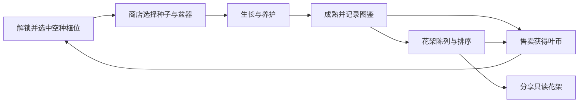
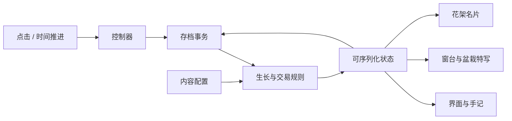

# 03 · 总体设计

## 玩法结构

窗台负责主要操作。场景内显示时间和种植位，右侧手记展示当前植物的生长阶段、湿度、养分和光照。商店和 3D 特写使用弹窗。顶部切换窗台、花架、邻里和图鉴，小屏下手记置于场景下方。

试玩从清晨开始，预置一盆展叶期洋甘菊与一个空位。玩家可以立即试种或照顾已有植物。自然时间持续推进，也可以手动快进 30 秒或等到下一指定时段。时段推进同时改变画面和规则层的光照。

## 模块边界

| 层 | 目录或入口 | 职责 |
| --- | --- | --- |
| 内容配置 | `shared/releases/v1/content.js` | 物种、盆器、种植位、时段和成就的稳定标识与数值。 |
| 规则 | `shared/releases/v1/simulation.js` | 成长积分、成熟结算、交易、展陈、成就和行为约束。可在 Node.js 中直接运行。 |
| 存档与分享 | `backend/`、`db/` | 关系数据库事务、后端存档和只读花架，旧名片由共享解码器读取。 |
| 控制器 | `frontend/src/main.js` | 组装模块，把输入转成 API 动作，更新当前视图与弹窗。 |
| 视图 | `frontend/src/ui/` | 导航、指标、选择、状态反馈和响应式布局，使用标准 HTML 控件。 |
| 渲染 | `frontend/src/render/` | 窗景、灯光、盆器、模型、选取、相机与资源释放。模型读取规则产出的植物状态。 |
| 构建与测试 | `scripts/`、`test/` | 原生 ES 模块静态部署、规则测试与构建预览。 |

## 迭代方式

| 改动 | 首要改动点 | 验证范围 |
| --- | --- | --- |
| 复用现有形态新增物种 | 加 `SPECIES` 条目、价格、习性和颜色 | 商店选择、模型、图鉴、分享兼容性和经济回路 |
| 新盆器或展示主题 | 盆器配置、模型工厂，主题只改渲染 | 排水规则、盆口缩放与特写构图 |
| 新植物形态 | 模型工厂和插画分支。后续可把工厂改为按 `model` 注册 GLB 加载器 | 各生长阶段、异色、触屏特写、资源回收 |
| 新事件或成就 | 在现有规则结算点增加一次性触发，内容配置记录奖项 | 刷新、离线补算和重复结算 |
| 云存档和联网花架 | 用服务端实现替换本地事务与花架读取，复用动作、展品和规则定义 | 幂等、并发、隐私、数据迁移和版本降级 |

配置键是存档与分享的一部分。删除或重命名既有物种、盆器或种植位前，需要迁移旧数据或保留别名。改动成长公式时保留旧的规则模块，窗台按记录的内容版本执行。联机实现与新增版本流程见[前后端拆分与扩展](06-前后端拆分与扩展.md)。
