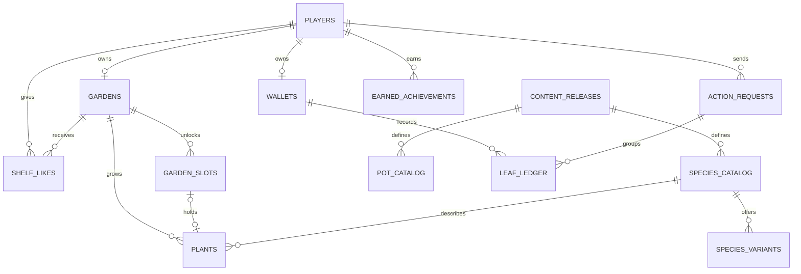

# 05 · 数据库设计

PostgreSQL 结构负责后端存档、种植交易和邻里花架。浏览器负责场景与交互，后端 API 接收玩家动作，调用生长规则并把结果写进数据库。首版每个访客有一个窗台，花架最多陈列八株。联机版默认使用本地 PGlite，也可通过 `DATABASE_URL` 连接独立 PostgreSQL 实例。

## 数据模型



| 领域 | 表或视图 | 关键设计 |
| --- | --- | --- |
| 玩家 | `players` | 内部 UUID。认证提供方的 `issuer + subject` 唯一，数据库只保留身份映射。 |
| 窗台 | `gardens`、`garden_slots`、`slot_catalog` | 窗台保存规则版本、逻辑时间、结算时点和修订号。`garden_slots` 每行是一个已解锁的位置。UI 用位置目录减去已解锁集合得到待解锁位置。 |
| 植株 | `plants` | 单一 UUID 贯穿种下、上架、售出。保存湿度、养分、补光档、成长进度、累计适配度、品质和外观种子。 |
| 内容 | `content_releases`、`species_catalog`、`species_variants`、`pot_catalog`、`achievement_catalog` | 稳定内容键配合发布版本。异色用独立的变种记录，能增加更多变种。原型数值由种子 SQL 写入。 |
| 图鉴 | `plant_album` | 由成熟植物记录得出总数、异色数、最高品质。售出的植株仍计入历史。 |
| 成就 | `earned_achievements` | 账号与成就键组合唯一，保留达成时的奖励配置版本。 |
| 叶币 | `wallets`、`leaf_ledger`、`action_requests` | 钱包保存余额，流水保留金额及来源，同一动作可产生购买和里程碑等多笔流水。 |
| 邻里 | `gardens` 发布字段、`shelf_likes`、`read_shared_shelf()` | 花架可私密、持链接可访问或公开。只读查询按位置返回展品。同一访客对同一花架只能留一个喜欢。 |

## 状态和约束

每株植物恰好处于三个位置状态之一。窗台盆栽填写 `slot_key`，花架展品填写 `shelf_position`，售出记录填写 `sold_at`。组合外键确保植物所在位置属于自己的窗台且已经解锁。同一窗台的盆位和花架位置各自唯一，花架位置限制在 1–8。成熟前只能留在盆位，成熟时需同时记录品质、变种和成熟时间。花架交换位置时，在事务内暂时延迟位置唯一约束，结束前恢复检查。 [PostgreSQL 约束文档](https://www.postgresql.org/docs/17/ddl-constraints.html)

植物携带播种时的 `content_version`。先发布新版本目录，再将适用的窗台升级。发布后的旧目录保留供旧植物、成就和展品查询。位置布局或时段规则改变时，首版选择等该窗台的植物都成熟后，再迁移窗台版本和位置配置。稳定键用于聚合跨版本的图鉴数据，重命名展示标题可以保留原键。

## 交易与离线补算

玩家操作由服务端完成，浏览器提交动作参数和 `request_id`。同一账号下的成功请求保留一份回执。重试时核对动作及规范化后的参数，相同则返回原回执，复用请求 ID 提交不同参数时返回冲突。每次写操作都在同一个短事务内，按固定顺序锁定玩家，再读取并锁定窗台。服务端校验身份与归属，补算成长，执行业务写入，保存回执和新版本号，然后提交。 [PostgreSQL 行锁文档](https://www.postgresql.org/docs/17/explicit-locking.html#LOCKING-ROWS)

| 动作 | 事务中处理的内容 |
| --- | --- |
| 首次进入 | 写入玩家、窗台、钱包、默认解锁位置和预置幼苗。用一笔 `opening` 流水发放启动叶币。 |
| 解锁或播种 | 按当前目录核价，校验位置和余额，写入解锁记录或植物，再写扣款流水。零价播种只写动作和植物。 |
| 成熟 | 服务端使用保存的种子和累计条件，写入一次成熟结果，同时发放符合条件的成就奖励。图鉴视图自动反映新结果。 |
| 陈列 | 更新同一株植物的盆位和花架位置，原盆位随之空出。 |
| 售卖 | 核对植物 UUID、归属、成熟状态和是否已售，按该株的目录版本和品质算价，再写售出状态与入账流水。 |

余额由流水的 `AFTER INSERT` 触发器更新。余额不足会使事务失败。数据库对首发叶币、同一株植物的售卖入账、同一成就的奖励入账分别设了唯一约束。游戏服务负责核算金额、保证状态更新与入账同事务，以及限制人工调账权限。保存成功回执与结果后才向客户端确认。失败的事务可以在重新获取状态后发起新的动作。

读取自己的窗台或执行养护动作时，后端按服务端时间与 `settled_at` 的差值计算整秒，按内容版本的上限补算。超出上限的实时间隔一起记为已处理，避免每次刷新继续补同一段。逻辑时间和时间戳与植物结果同时提交。浏览器只插值显示进度，避免每秒向数据库写入。测试版的快进按钮接入联网后应由测试环境单独授权。

## 花架、权限和本地档

| 可见性 | 按名片链接读取 | 出现在邻里列表 |
| --- | --- | --- |
| `private` | 关闭 | 关闭 |
| `unlisted` | 开放 | 关闭 |
| `public` | 开放 | 开放 |

发布时发放随机 UUID 令牌。联网名片展示当前花架，撤回发布会清空令牌，再发布时生成新令牌。公开列表按发布时间和 ID 分页，只有 `public` 参与索引。访客查询只返回花架标题、展品外观与喜欢数。点赞用“设为喜欢”或“取消喜欢”表示目标状态，重复请求不会累加。后端需在写入喜欢前确认花架可访问，数据库约束负责拒绝重复喜欢和自赞。

数据库仅接受后端连接。迁移账号管理结构和内容版本，运行账号使用最小权限。对 `leaf_ledger` 授权插入和所需查询，对 `wallets` 只开放查询与初始化 `player_id` 的列权限，余额由触发器修改。分享接口调用只读查询，禁止返回玩家认证、余额、养护过程和私密花架。当前 SQL 将业务表置于独立的 `windowsill` schema 并撤销了 `PUBLIC` 权限。接入时按实际部署角色配置授权。

本地试玩存档含 `slots`、`shelf`、`album`、`coins` 和累计值。`seed`、`score`、`samples` 分别对应 `visual_seed`、`fit_sum`、`fit_samples`。本地存档由玩家浏览器控制，也缺少历史售出植株明细。首版联网账号从服务端初始化。若后续支持导入，可先把旧花架保留为独立的纪念展览，叶币与联机成就走服务端账本。

## Blender 资产接入

复杂花盆和植物可以用 Blender 制作，导出 glTF Binary（`.glb`），再由 Three.js 的 `GLTFLoader` 加载。沿用现有盆栽模型入口，让主场景和特写共享同一套资产。植物模型的原点放在土面中心，盆器模型的原点放在底座中心。可以按生长阶段导出不同模型，也可以预留命名材质槽，让异色只换叶片或花瓣材质。数据库的 `render_config` 存版本化的模型路径或资产键，GLB 文件由静态资源服务交付。 [Blender glTF 导出说明](https://docs.blender.org/manual/en/3.2/addons/import_export/scene_gltf2.html) · [Three.js GLTFLoader](https://threejs.org/docs/pages/GLTFLoader.html)

## 建库与验证

在项目根目录执行以下命令。先用本机空的开发库验证，`001` 和 `002` 每库执行一次。测试用例会回滚创建的临时测试记录。

```powershell
$env:PGCLIENTENCODING = 'UTF8'
createdb windowsill_dev
psql -X -v ON_ERROR_STOP=1 -d windowsill_dev -f db/001_initial_schema.sql -f db/002_seed_demo_catalog.sql -f db/smoke_test.sql
```

- [`001_initial_schema.sql`](../db/001_initial_schema.sql) 创建表、约束、索引、账本触发器和花架查询。
- [`002_seed_demo_catalog.sql`](../db/002_seed_demo_catalog.sql) 写入试玩的三种植物、三种盆器、三个盆位、六项成就与时段设置。
- [`003_online_runtime.sql`](../db/003_online_runtime.sql) 保存植物首次上架时间和成就达成时的逻辑秒。
- [`004_demo_neighbors.sql`](../db/004_demo_neighbors.sql) 将示范花架作为可访问的邻里记录。
- [`smoke_test.sql`](../db/smoke_test.sql) 覆盖余额回滚、重复入账、同盆位占用、错误变种、未成熟上架、花架排序、隐私、喜欢和售卖后图鉴。

后端通过 `npm run db:migrate` 或开发启动自动应用编号迁移。已在 PGlite 验证迁移、入账、花架权限和数据库重开。生产部署时用目标 PostgreSQL 的应用角色和多连接重复权限及并发测试。 [PGlite 文档](https://pglite.dev/docs/about)
