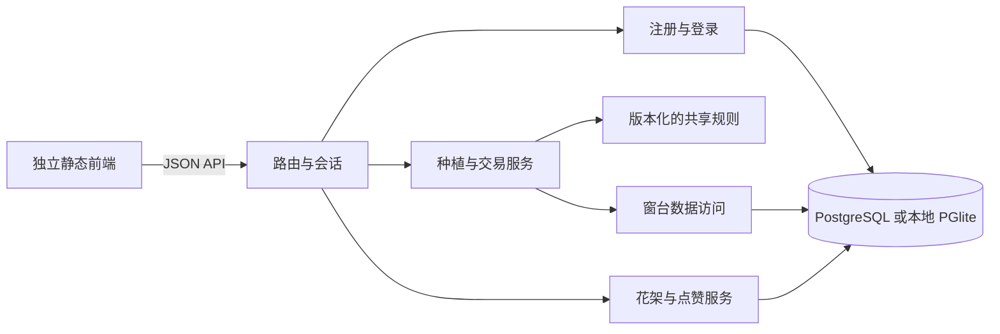

# 06 · 前后端拆分与扩展

## 接口与数据所有权

| 接口 | 用途 |
| --- | --- |
| `POST /api/session` | 恢复已有会话，或为首次访问创建访客档。 |
| `POST /api/auth/register` | 接收 `{username, password}`，创建账号，绑定当前联网访客的进度并签发登录会话。 |
| `POST /api/auth/login` | 接收 `{username, password}`，验证密码并签发新会话。 |
| `POST /api/auth/logout` | 撤销当前设备的登录会话。 |
| `GET /api/garden` | 补算时间并返回当前玩家的窗台、图鉴、花架、叶币和账号摘要。 |
| `POST /api/garden/actions` | 提交 `{requestId, action}`。涵盖养护、种植、售卖、花架排序、发布和撤回。 |
| `GET /api/neighbors` | 读取最近发布的公开花架。 |
| `GET /api/shelves/{token}` | 按名片令牌读取花架，持链接可见的花架也可访问。 |
| `PUT` 或 `DELETE /api/shelves/{token}/like` | 设置或取消喜欢。重复提交同一状态不会累加。 |

后端生成植株 ID 和外观随机种子，按服务端时钟补算成长，并在同一事务内写入植物、成就和流水。前端提交意图，使用服务器返回的余额和植株状态。网络重试复用请求编号，防止动作执行两次。客户端更换盆栽时，养护和交易通过 UUID 校验对象。

访客和登录使用独立的 HttpOnly Cookie。账号按用户名关联同一份服务端进度。注册后旧访客凭证失效。登录已有账号时保留浏览器原有的独立访客档，退出后回到该访客档。登录会话七天过期，也可主动退出撤销。后端使用独立盐值计算 scrypt 密码哈希，按来源 IP 限制注册和登录请求。多实例部署时，限速应由入口网关统一执行。 [OWASP 密码存储](https://cheatsheetseries.owasp.org/cheatsheets/Password_Storage_Cheat_Sheet.html) · [OWASP 会话管理](https://cheatsheetseries.owasp.org/cheatsheets/Session_Management_Cheat_Sheet.html)

此前单机浏览器档案保留在原浏览器，联机档由服务端初始化。旧快照链接仍可预览，新的联网名片会随花架更新并可撤回。

## 扩展路径

| 想增加的功能 | 改动入口 |
| --- | --- |
| 物种、盆器、时段和成长公式 | 在 `shared/releases/` 新增规则版本并注册，再增加编号 SQL 迁移。同步更新前端物种目录和阶段展示，保留旧版本供已有窗台和展品定价。 |
| Blender 花盆或植物 | 资源放在 `frontend/assets/`，通过版本化模型键引用。渲染模块负责加载 GLB 和切换材质，种植交易接口继续使用物种及盆器键。 |
| 新养护动作或任务 | 在规则模块定义行为，再接入后端验证与数据库映射。浏览器按钮只提交动作，不参与结算。 |
| 公共邻里搜索、分页或好友 | 在 `backend/shelf-service.js` 扩展访问规则和查询，通过新迁移增加必要索引与关系表。 |
| 独立数据库或部署方式 | 保持服务接口，通过 `backend/database.js` 的事务适配层连接 PostgreSQL。共享规则和前端资源独立构建。 |

发布内容版本时，先增加新的目录行，再部署能识别新旧版本的服务和前端，最后启用新版本。已有窗台升级应先完成成长，再迁移位置和时段版本。旧展品的售价沿用植株记录的版本。新增 API 字段优先保持向后兼容，已有编号迁移通过追加脚本演进。

内容版本 2 由 `006_succulent_catalog.sql` 建立，在原目录之外增加熊童子、玉露、桃蛋和「窗边多肉册」。时钟、盆器、原有种子参数保持一致。已存在的窗台在下一次请求时，由后端在同一事务内按旧版规则补算、升级窗台与盆位目录。已种植的盆栽保留自身内容版本，因此旧异色、花架和售价仍能读取。原有「一本花簿」仍按原三种植物结算。

新物种的成长阶段由数值索引决定，名称可以在物种目录单独设置。熊童子和桃蛋用可调整的程序化模型。玉露按阶段从 `frontend/assets/plants/haworthia/` 加载 GLB，以土面中心为原点，Y 轴向上。新模型集可在 `frontend/src/render/model-assets.js` 注册。玉露加载期间或请求失败时使用程序化模型，缺少 WebGL 2 时用插画。构建产物包含本地加载器和贴图内嵌的 GLB，无需访问外部 CDN。

## 运行配置

| 环境变量 | 用途 |
| --- | --- |
| `PLANT_PORT` | 前端本地端口，开发默认 5173，预览默认 4173。 |
| `PLANT_API_PORT`、`PLANT_API_HOST` | 后端端口与监听地址，默认 `3001` 和 `127.0.0.1`。 |
| `PLANT_API_URL` | 本地前端服务器注入的 API 根地址，包含 `/api`。 |
| `PLANT_FRONTEND_ORIGINS` | 后端允许的浏览器来源，使用逗号分隔。 |
| `PLANT_TRUST_LOOPBACK_PROXY=1` | 单机反向代理覆盖 `X-Real-IP` 时开启，按转发后的来源 IP 限制注册和登录。 |
| `PLANT_DB_DIR` | 本地 PGlite 目录，默认 `.data/postgres/`，单实例使用。 |
| `DATABASE_URL` | 独立 PostgreSQL 的连接串，仅供后端进程使用。 |
| `NODE_ENV=production` | 强制外部 PostgreSQL、关闭快进、使用 Secure Cookie。 |

生产环境可分别部署前端和后端，通过 HTTPS 反向代理把 `/api` 指向后端。设定允许的网页来源，先用迁移账号运行 `npm run db:migrate`，再用受限的运行账号启动 API。使用 Cookie 的跨来源部署应保持同站点，并明确配置来源白名单。 [Node PostgreSQL 事务](https://node-postgres.com/features/transactions)

## 版本提交

每完成一个可运行版本，运行 `npm test` 和 `npm run build`，再提交并推送到 `dagcog/plant` 公开仓库。提交源码、迁移、测试和文档，排除本地存档、环境密钥、依赖、构建产物和截图。交付时报告 GitHub 提交链接和验证结果。
